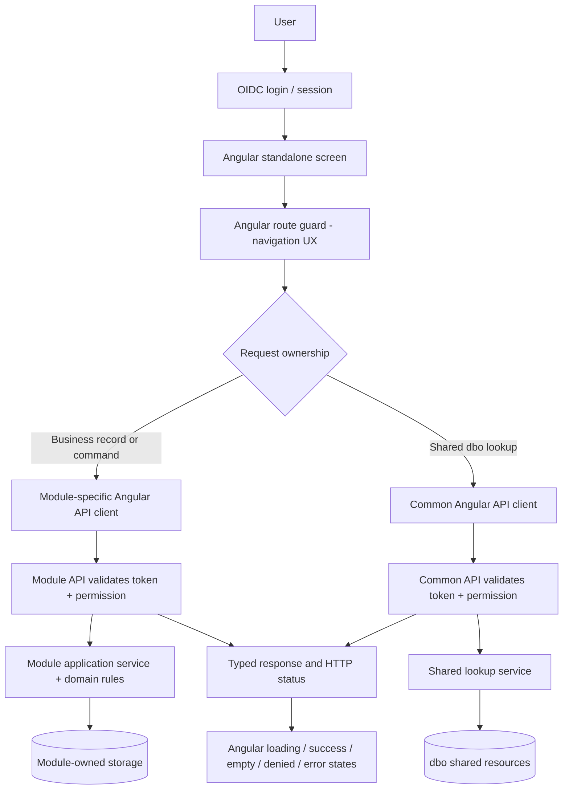

# ScreenShift — Traditional ASP.NET to Modular Angular/.NET Architecture

> **Architecture specification.** Fictional Orders/Shared lookups are used throughout. Do not put employer source code, credentials or private schemas into this public repository.

## Goal

ScreenShift must migrate the *behavior* of a legacy enterprise Web Forms application, not just copy its UI. The target is an Angular application with independent module APIs, a Common API for explicitly shared `dbo` resources, and authentication/authorization enforced at **every API boundary**.

### Request flow



**Authorization rule:** an Angular guard, hidden button, role claim in browser state, URL parameter, or SQL schema name must never be treated as an access grant. Every backend API revalidates the identity, authorization policy, per-resource access, and user/tenant boundaries. A module may not bypass Common API policies by querying shared `dbo` resources directly in violation of the reviewed ownership map.

## Mapping the traditional application

| Legacy source/behavior | Target implementation | Required verification |
|---|---|---|
| `.aspx` markup | Accessible Angular standalone component/template | UX and keyboard parity |
| `.aspx.cs` / Page_Load | Angular lifecycle + data-access service | Postback ordering and conditional loads |
| Web Forms button events | Angular handlers calling module API commands | Business validation and transactions |
| GridView / Telerik RadGrid | Angular table/pagination/filter controls | Server pagination, sort, export, accessibility |
| RequiredFieldValidator/custom validator | Reactive form validators + server validators | Cross-field and resource-specific rules |
| Session/ViewState | Authorized session and bounded state management | No security decisions solely in browser |
| Legacy roles/Authorize checks | Route guard for UX **plus server policies on both APIs** | Claim mapping, roles, denied outcomes |
| Inline SQL / business logic | Module service + repository | Data ownership, concurrency, audit, invariants |
| Shared `dbo` lookup/query | Named endpoint in Common API with explicit policy | Confirm ownership, allowed fields and permissions |
| Reporting/export | Authenticated, authorized module/report endpoint | Data scope, privacy and audit |

## Roles and permissions

Use a reviewed permission matrix. Never hardcode blanket administrative access or use unrestricted `dbo` table access as an endpoint.

| Screen operation | Owning API | HTTP | Example permission |
|---|---|---|---|
| List business items | Orders.API | GET | `orders.read` |
| Save business item | Orders.API | POST | `orders.write` |
| Shared region lookup | Common.API | GET | `common.lookup.read` |

The identity provider is configured using trusted issuer/audience/key validation. Define role/claim normalization explicitly. Each module API and Common API must configure authentication middleware and deny-by-default authorization policies independently. Resource/record ownership requires domain-specific checks beyond endpoint claims.

## Example end-to-end screen

A synthetic Order Editor illustrates the complete sequence:

1. Navigate to `/orders/edit`: Angular checks whether a user is authenticated and whether its UX claims allow navigating.
2. Resolve lookups through `GET /api/common/lookups/regions`, authenticated and authorized using `common.lookup.read` on **Common.API**.
3. Resolve business data through `GET /api/orders/items`, authenticated and authorized using `orders.read` on **Orders.API**.
4. Show loading, empty, success, `401`, `403` and network failure states explicitly.
5. On submit, validate Angular form input, call `POST /api/orders/items`, and **re-authorize** with `orders.write` on Orders.API.
6. Orders.API validates the DTO, record permissions and business rules, writes via its module service/repository, and returns a typed response.
7. Angular updates UI only after an actual successful API response.

HTTP contract: `401` unauthenticated; `403` authenticated but forbidden; `404` absent/concealed record; `400/422` validation failure; `409` domain/concurrency conflict; `5xx` server failure. Do not quietly transform `403` into an empty list or execute writes after permission failure.

## Module/API boundaries

```text
angular/src/app/
  core/auth/               # OIDC adapter, guards, HTTP interceptor
  core/http/               # error mapping, tokens only to trusted API origins
  features/orders/         # components and screen data-access service
  api/orders.api-client.ts # business endpoints
  api/common.api-client.ts # shared dbo lookup endpoints

backend/
  Orders.API/              # policies, controllers, domain services, repositories
  Common.API/              # independent policies, dbo shared-data services
  Contracts/               # reviewed versioned DTO contracts
```

No direct Angular-to-database requests. Common API should expose **named, authorized shared resources**, not an endpoint accepting arbitrary table names or SQL. Cross-API calls must use independently authorized service credentials when permitted.

## How ScreenShift should perform the transition

**Stage 1 — Discover:** Parse Web Forms pages, code-behind, controls, event handlers, Angular services, attributed controllers, literal routes, authorization annotations and `dbo` references. Preserve source location and uncertainty.

**Stage 2 — Confirm ownership:** Require a target manifest mapping each legacy page to a business module, Angular route, required read/write endpoints, Common API lookups, permissions and resource ownership. Do not infer a permission from SQL schema.

**Stage 3 — Build dependency graph:** Show screen → service → API endpoint → policy → service/repository → database access; distinguish *verified mapping*, *static evidence*, *candidate*, and *unresolved*.

**Stage 4 — Generate:** Produce Angular standalone components, data-access services, typed API contracts, route guards, validators and .NET endpoint skeletons. Unported business logic must remain explicit `TODO` / `501` rather than silently pretending to work.

**Stage 5 — Verify:** Test old/new behavior equivalence; denied identity, wrong role, cross-resource access, bad DTO, concurrency, accessibility, paging, errors and audit logs. Require human review for ambiguous flows.

## Acceptance gates

- Screen routes, buttons, fields and validations mapped and tested.
- Every API binding identifies its owning module/Common API, HTTP method, route, DTO, required permission and observed evidence.
- Each API independently handles anonymous, insufficient-permission and allowed requests without leaked data.
- Shared `dbo` reads stay behind the reviewed Common API boundary; module writes stay behind module API.
- Loading, empty, success, `401`, `403`, validation, retry, network and conflict cases are exercised.
- Backend business semantics, transactions, row-level scope and audit behavior verified against independently approved tests.
- No employer-owned source or sensitive material committed to this public repository.

**Important:** This specification is the desired migration architecture—not proof that ScreenShift's current heuristic engine provides full behavior-equivalent migration or security certification. Static annotations alone do not prove authorization.
